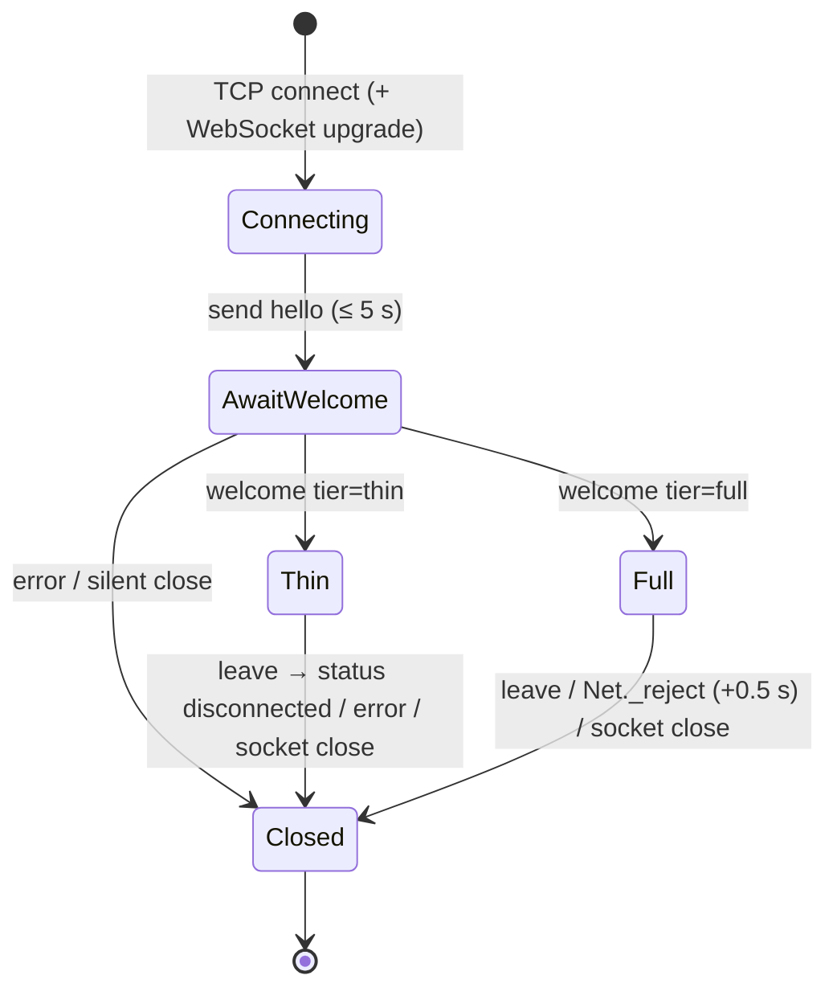

# Open Protocol v1: common layer (normative)

This document specifies everything both tiers share: endpoints, framing, the
hello/welcome/error handshake, version negotiation, ping, leave, timeouts, and
limits. Tier-specific behaviour is in [spec-thin.md](spec-thin.md) and
[spec-full.md](spec-full.md).

The key words MUST, MUST NOT, SHOULD, SHOULD NOT and MAY are used as in RFC 2119.
"Server" means the Fallout Forecast dedicated server (Godot 4.7.2,
`-- --server`). "Client" means your implementation.

## 1. Conventions

- **Byte order.** Every multi-byte binary integer and float is little-endian.
- **Text.** JSON messages are UTF-8 without a BOM, one JSON object per message.
  Every JSON message is an object with a string field `t` (the message type).
- **Numbers in JSON.** The server's JSON encoder (Godot `JSON.stringify`) writes
  floats with a fractional part even when integral (`100.0`, `0.0`, `12.0`) and
  echoes some integers it received as floats (`{"t":"pong","ms":4242.0}` on the
  Thin tier, see [KNOWN_ISSUES.md](KNOWN_ISSUES.md#1-thin-ping-number-format)). Clients MUST accept both JSON number spellings and preserve integer
  values where this spec says *integer*. Clients MUST NOT reject `12.0` where an integer is expected.
  Integer values the server sends can exceed 2^32 (for example Thin pickup and
  puddle ids such as `-303080413257`); they always fit in a signed 64-bit integer
  and in a double without loss (|n| ≤ 2^53).
- **Unknown data.** Clients MUST ignore unknown JSON keys and unknown message
  types from a server that speaks the same `v`. This is how compatible
  extensions are added.
- **World units** (both tiers): metres, seconds, radians. Godot axes: right-handed,
  **+Y up**, **-Z forward** when yaw = 0, **+X right**. Yaw is rotation about +Y;
  positive yaw turns left (counter-clockwise seen from above). A body with yaw `y`
  faces `(-sin y, 0, -cos y)`. Pitch is rotation of the head about its local +X;
  positive pitch looks up; the server clamps pitch to ±88° (±1.5359 rad).
  Positions are the player's **feet** (capsule bottom). See
  [game-reference.md §1](game-reference.md#1-units-and-axes).

## 2. Endpoints and transports

One dedicated server process exposes three listeners:

| Listener | Default port | Purpose |
| --- | ---: | --- |
| Native Godot WebSocket | 7777 | Godot `SceneMultiplayer` clients (the official game). Not part of this protocol. |
| Open Protocol WebSocket | **7780** | Both tiers, RFC 6455 WebSocket, any request path (`/`). |
| Open Protocol raw TCP | **7781** | Both tiers, length-prefixed frames (§3.2). |

- The server operator can change or disable the two Open Protocol ports
  (`--thin-port=N`, `--thin-tcp-port=N`, `0` disables) and the native port
  (`--port=N`). Clients MUST let the user configure host and port. Examples in
  these docs use `<server-host>`.
- Both Open Protocol listeners speak **plaintext**. For public deployments the
  operator puts a TLS-terminating proxy in front of 7780 (clients then use
  `wss://<server-host>/...`). The raw TCP listener has no encryption. A client
  SHOULD support `wss://` when it is a WebSocket client.
- The server does not negotiate `permessage-deflate` or a WebSocket subprotocol.
  Clients SHOULD use an ordinary upgrade without either extension.
- The server sends WebSocket pings every 2 s (`heartbeat_interval = 2.0`); a
  conforming WebSocket library answers them automatically. WebSocket control
  frames are independent of the JSON `ping`/`pong` messages in §6.

## 3. Framing

### 3.1 WebSocket (port 7780)

- One Open Protocol message = one WebSocket message. JSON uses the **text**
  opcode (0x1); binary messages use the **binary** opcode (0x2). Fragmentation is
  handled by the WebSocket layer.
- A client MUST NOT send a message larger than 65,536 bytes; the server closes the
  connection without an `error` if it receives one.
- Server messages can be larger (the outbound buffer is 512 KiB); clients SHOULD
  accept messages up to 524,284 bytes. In practice the largest are the Thin `map`
  outline (tens of KiB) and Full `WeatherManager._sync_puddles` / roster frames.

### 3.2 Raw TCP (port 7781)

Every message, in both directions, is:

| Offset | Size | Type | Field |
| ---: | ---: | --- | --- |
| 0 | 4 | u32 LE | `length` = payload byte count, excluding these 4 bytes |
| 4 | `length` | bytes | payload |

- No delimiters, padding, or alignment between frames. TCP is a byte stream:
  clients MUST buffer partial reads and MUST split coalesced frames.
- **Text vs binary** is decided by the first payload byte: `0x00`–`0x08` means a
  binary frame (see the tag registry in §9); any other first byte means UTF-8 JSON.
  JSON payloads therefore MUST start with `{` (or JSON whitespace) — never with a
  control byte.
- Client → server: `length` MUST be 1–65,536. `0` or anything larger makes the
  server close the socket without an `error`. The server also closes a connection
  whose unread input exceeds 131,072 bytes.
- Server → client: `length` is 1–524,284. If a slow client lets the server's
  outbound buffer exceed 524,288 bytes the server closes the connection. Read
  continuously.

Example: JSON `{"t":"ping","ms":7}` (19 bytes) on raw TCP is the 23 bytes

```text
13 00 00 00 7b 22 74 22 3a 22 70 69 6e 67 22 2c 22 6d 73 22 3a 37 7d
```

On WebSocket the same message is just the 19-byte text payload.

## 4. Handshake: hello, welcome, error

The **first** message on every connection MUST be a JSON `hello`, sent within
**5 seconds** of the TCP connection being accepted (the 5 s includes the
WebSocket upgrade). `hello` is always JSON text, even when it negotiates
binary. Send exactly one `hello` and wait for `welcome` or `error` before sending
anything else; the server reads only one frame before the handshake completes.

### 4.1 `hello` (client → server)

| Field | Type | Required | Meaning |
| --- | --- | --- | --- |
| `t` | `"hello"` | yes | |
| `v` | integer | yes | Open Protocol major version. MUST be `1`. |
| `tier` | `"thin"` \| `"full"` | no, default `"thin"` | Which tier to speak ([AGENTS.md](AGENTS.md#choosing-a-tier)). |
| `enc` | `"json"` \| `"bin"` | no, default `"json"` | Data-frame encoding for the tier (§5). Control messages stay JSON. |
| `name` | string | no, Thin only | Callsign. Full ignores it (Full sends its name in `Net._hello`). |
| `client` | string | no | Free-form client/version string, e.g. `"3ds-port/0.3"`. Informational. |
| `code` | string | only if the server has a join code | Shared secret. Applies to both transports and tiers. |
| tier fields | | no | Thin: `rate`, `radius`, `max_enemies` ([spec-thin.md §2](spec-thin.md#2-negotiation)). |

### 4.2 Server validation order

The server checks, in this order, and answers the **first** failure with a
terminal `error` (§4.4) followed by close:

1. The frame is a JSON object with string `t` → else `Expected an Open Protocol message`.
2. `t == "hello"` and `v` is the integer `1` → else `Expected hello with Open Protocol v1`.
3. Join code: if the server has one, `code` MUST equal it exactly → else `Invalid join code`.
   An address with 5 wrong codes in a minute is refused for 60 s (doubling on
   each repeat, up to 1 h), and after 30 wrong codes in a minute across all
   addresses the server stops checking codes for the rest of that minute. In
   both cases the answer is `Too many join attempts, try again later`. A
   refused address can also be disconnected at TCP accept without any message.
4. `enc` is `"json"` or `"bin"` (missing = `"json"`) → else `Unsupported encoding`.
5. Fewer than 12 established Open Protocol connections (Thin sessions plus Full
   peers) → else `Too many Open Protocol connections`.
6. `tier` is `"thin"` or `"full"` (missing = `"thin"`) → else `Unsupported tier`.
   A Full hello on a server built without the Full tier → `full tier unavailable`;
   a server whose Full adapter is not running → `Full tier server is not active`
   or `Server is not accepting connections`.
7. Thin only: fewer than 4 players in the roster → else `SERVER FULL`.
   (Full peers are admitted to the transport first and rejected later by the game
   handshake with `Net._reject("SERVER FULL")`, see [spec-full.md §3](spec-full.md#3-game-handshake-net_hello).)

### 4.3 `welcome` (server → client)

| Field | Type | Meaning |
| --- | --- | --- |
| `t` | `"welcome"` | |
| `v` | integer | Accepted Open Protocol version (`1`). |
| `tier` | string | Accepted tier. |
| `enc` | string | Accepted encoding. |
| `you` | integer ≥ 2 | Your player id. Thin: small sequential ids starting at 2. Full: a random positive 31-bit Godot peer id (e.g. `234289745`). Peer 1 is the server and never a player. |
| `game_protocol` | integer | The game's own protocol number (`Net.PROTOCOL`, currently **19**). Full clients MUST compare it with the protocol they implement (§5). |
| `maps` | array of `{id, name}` | Selectable maps, e.g. `[{"id":"pinecrest","name":"PINECREST"},{"id":"harbor","name":"HARBOR POINT"},{"id":"maple_hollow","name":"MAPLE HOLLOW"}]`. Discover maps from here; do not hard-code. |
| tier fields | | Thin echoes `rate`, `radius`, `max_enemies`. |

### 4.4 `error` (server → client)

`{"t":"error","msg":"<human readable>"}`. Display `msg`; do not parse it.

- **Before or during the handshake**, and **any time on the Thin tier**, `error` is
  terminal: the server closes the connection right after it (the close flushes
  queued data for up to 1 s).
- **On the Full tier after `welcome`**, errors for bad application frames are
  non-terminal ([spec-full.md §11](spec-full.md#11-errors)). A server-initiated
  close can also send an `error` before closing.
- A server-initiated close sends a WebSocket close reason or a JSON `error` when
  the transport can still write. Handle EOF or an abnormal WebSocket close even
  if no diagnostic arrives (for instance, after transport loss, a missed
  WebSocket pong, an upgrade failure, or a full outbound queue).

## 5. Version negotiation

There are two independent numbers:

| Number | Where | Changes when | Client rule |
| --- | --- | --- | --- |
| Open Protocol `v` | `hello.v`, `welcome.v` | The envelope, framing, Thin messages/layouts, or Full frame/Variant mapping change incompatibly. | Send `1`. If the server answers `Expected hello with Open Protocol v1`, it speaks another major version; stop. |
| `game_protocol` | `welcome.game_protocol` | Any game RPC signature, replicated payload, or networked node path changes (`Net.PROTOCOL`). | **Full:** MUST match the RPC schema you implemented ([open-protocol-schema.json](open-protocol-schema.json) `game_protocol`); send it as `Net._hello`'s second argument; a mismatch is rejected with `UPDATE REQUIRED (vS, YOU HAVE vC)`. **Thin:** informational only; Thin messages are versioned by `v`, so a Thin client keeps working across game-protocol bumps. |

There is no minor-version negotiation. Compatible additions (new JSON keys, new
message types, new event kinds, appended enum values) can appear without a `v`
bump; §1 "Unknown data" makes them safe. Binary Thin layouts are **not**
extensible without a `v` bump.

## 6. Ping and pong

After `welcome`, either tier MAY send `{"t":"ping","ms":<integer>}` at any
time; the server answers `{"t":"pong","ms":<same value>}`. `ms` is the sender's
own clock (no clock sync is implied). Use it to measure round-trip time. These
are always JSON, independent of `enc`. The Thin tier echoes the number as a
float (`7.0`); the Full tier echoes integral values as integers.

The Full tier additionally has a game-level RTT probe (`Net._rtt_ping` /
`Net._rtt_pong`) that a Full client MUST answer; see
[client-responsibilities.md](client-responsibilities.md#4-rtt-keepalive).

## 7. Leaving, disconnects and timeouts

- **Leave:** send `{"t":"leave"}` (JSON, both tiers). Thin answers
  `{"t":"status","state":"disconnected","msg":"Left session"}` and closes; Full
  closes without a reply. The server removes you from the roster immediately and
  tells the other players.
- **Abrupt close:** closing the socket without `leave` has the same effect when the
  server notices the close.
- **Rejoin:** there is no session resumption. Open a new connection; you get a new
  id. A run in progress accepts late joiners (Thin: `load` right after the lobby;
  Full: `Net._start_run` right after the roster).
- **Timeouts:**

| Timer | Value | Effect |
| --- | --- | --- |
| Hello deadline | 5 s from TCP accept | Connection closes if no complete `hello` frame. Sends an error if framing is available. |
| Close flush | ≤ 1 s | After `error`/`leave` the server flushes queued data, then drops the socket. |
| WebSocket heartbeat | 20 s | The server sends WebSocket Ping control frames and waits up to one interval for a Pong. Applies to both tiers, including during load. |
| Thin input watchdog | 500 ms | No valid `in` for 500 ms → movement and held buttons go neutral (view is kept). |
| Full join deadline | 10 s from `welcome` | A Full peer not in the roster by then (no accepted `Net._hello`) is disconnected ([KNOWN_ISSUES.md](KNOWN_ISSUES.md#2-full-lobby-handshake-timeout)). |
| Idle | none | WebSocket uses transport heartbeats. Raw TCP detects closure at the socket layer. |

WebSocket clients MUST respond to control-frame Pings with Pongs. Most libraries
do this while polling. The JSON `ping` and `pong` messages in §6 are independent
of these control frames. Keep the transport polling during loading when possible.

## 8. Limits

| Limit | Value |
| --- | --- |
| Players per server (all tiers + native combined) | **4** |
| Established Open Protocol connections (Thin sessions + Full peers) | 12 |
| Pending connections (no valid `hello` yet) | 16 in total, 3 per client address |
| New connections admitted per listener per server frame | 4 (the server ticks at 60 Hz); refused connections are closed at accept |
| Wrong join codes | 5 per address per minute (then a 60 s–1 h cooldown); 30 per minute server-wide |
| Client → server message size | 1–65,536 bytes |
| Server → client message size | up to 524,284 bytes |
| Server outbound buffer per connection | 524,288 bytes (reliable overflow closes; Thin snapshots wait for transport capacity) |
| Callsign (Thin `hello.name`) | 18 characters after cleaning |
| Full `Net._hello` name | 32 characters after cleaning; `Net._request_name` 18 |
| Lobby chat | 100 characters, 1 message / 700 ms / player, server keeps the last 30 |
| Thin snapshot rate | 2–20 Hz target (default 20). The server sends up to 2 Hz until the client signals readiness or the 15 s loading grace period expires ([Thin §3](spec-thin.md#3-session-state-machine)). |
| Thin input rate | SHOULD be 30 Hz; queue holds 32 frames |
| Thin events buffered between snapshots | 256 |
| Full RPC arguments | 0–255 per call |

## 9. Binary tag registry

The first byte of every binary message (both transports) is a tag:

| Tag | Tier | Direction | Message |
| ---: | --- | --- | --- |
| `0x01` | Thin | C → S | Input, 17 bytes ([spec-thin.md §5.2](spec-thin.md#52-binary-input-17-bytes)) |
| `0x02` | Thin | S → C | Snapshot ([spec-thin.md §7](spec-thin.md#7-binary-snapshot-layout)) |
| `0x03` | Full | both | RPC ([spec-full.md §8](spec-full.md#8-binary-frames-encbin)) |
| `0x04` | Full | both | Raw `SceneMultiplayer` bytes (unused by the game) |
| `0x00`, `0x05`–`0x08` | — | — | Reserved. Never sent. |

## 10. Connection state machine



The per-tier states inside `Thin` and `Full` are in
[spec-thin.md §3](spec-thin.md#3-session-state-machine) and
[spec-full.md §5](spec-full.md#5-run-lifecycle).

## 11. Security notes

- The join code is a shared secret sent in cleartext unless a TLS proxy is used.
  Use a long random code (12+ characters); the server rate-limits wrong codes
  (§8) but a short code can still be guessed over days.
- The join code gates only the Open Protocol listeners. The native Godot port
  has no join code, and a Full client can do anything a native client can, so
  setting a code does not make a server private.
- The server cleans every callsign and chat line (control characters, bidi
  overrides and `[`/`]` are removed or replaced) and escapes control characters
  in its JSON output, so server JSON is always valid RFC 8259 JSON.
- Thin clients cannot cheat on simulation: the server owns movement and combat.
  Full clients are trusted for their own movement and exposure, like native Godot
  clients; the server validates shots (origin within 3 m of the server-side
  camera, line of sight, ammo, fire interval) but not movement speed.
- Clients MUST treat all server strings (names, chat, prompts, banners) as
  untrusted display text.
