# Open Protocol v1: Full tier (normative)

The Full tier lets a complete port (3DS, Switch homebrew, ESP32 with a real
renderer, C/C++/Rust/Unity/Unreal/Node clients) join the same lobby and runs as
the official Godot game. **You run your own player** — movement, collision,
camera, local effects, audio — exactly like a native Godot client, and you
exchange the game's real RPCs with the server in an engine-neutral form.

Read [spec-common.md](spec-common.md) first. What your client must simulate and
report is in [client-responsibilities.md](client-responsibilities.md); every RPC
is listed in [rpc-catalog.md](rpc-catalog.md) (machine-readable:
[open-protocol-schema.json](open-protocol-schema.json)).

## 1. Model

- On the server, each Full connection becomes a first-class Godot multiplayer
  peer with a real peer id (`welcome.you`). The server translates Godot
  `SceneMultiplayer` packets to and from this wire format and hides Godot's path
  cache, node-id compression and method-index tables. You address **nodes by
  path** (relative to `/root`, e.g. `Net`, `Main/Players/P_234289745`) and
  **methods by name**.
- Everything is an RPC except the control messages `hello`, `welcome`, `error`,
  `ping`, `pong`, `leave` (always JSON text).
- Topology is client ↔ server only. You never talk to another client directly;
  the server relays (`_push_*` from you → `_relay_*`/`_apply_*` to everyone).
- Authority: the server (peer 1) owns autoloads (`Net`, `GameManager`,
  `WeatherManager`) and scene nodes. **Your player node
  `Main/Players/P_<you>` and its children are owned by you**; you send its
  `_push_transform`, `_report_exposure`, etc. The server still owns your health,
  inventory and all combat outcomes.
- Every game RPC is `call_remote`: the server never executes it for itself and
  echoes nothing implicitly. The 8 *relayed* RPCs are explicitly re-sent to
  every relevant peer **including you** (see §12).

## 2. Open Protocol handshake

```json
{"t":"hello","v":1,"tier":"full","enc":"json","client":"my-port/0.1"}
```

`enc` is `"json"` (RPCs as JSON text) or `"bin"` (RPCs as binary frames, §8).
`name` is ignored on Full. Reply:

```json
{"t":"welcome","v":1,"tier":"full","enc":"json","you":234289745,"game_protocol":19,"maps":[{"id":"pinecrest","name":"PINECREST"},{"id":"harbor","name":"HARBOR POINT"},{"id":"maple_hollow","name":"MAPLE HOLLOW"}]}
```

- `you` is your peer id (random, 2 … 2^31-1). Your player node in a run is
  `Main/Players/P_<you>`.
- `game_protocol` MUST equal the protocol your RPC implementation targets
  (`open-protocol-schema.json` → `game_protocol`, currently 19). If it differs,
  your RPC table is stale: stop, or regenerate your bindings.
- From now on the server may already send you `Net._rtt_ping` (1 Hz) and some
  broadcasts; answer `_rtt_ping` (§ [client-responsibilities §4](client-responsibilities.md#4-rtt-keepalive)).
  You are not yet a player.

## 3. Game handshake (`Net._hello`)

Send, reliably:

`Net._hello(hello: String, protocol: int)`

- `hello` is a **JSON-encoded string** (a string argument whose content is
  JSON): `{"name":"<display name>","color":<0-9>,"skin":<0-4>,"colors":[<unlocked color indices>]}`.
  - `name`: string, cut to 32 characters (not otherwise cleaned; keep it plain
    printable text, see [KNOWN_ISSUES.md](KNOWN_ISSUES.md#4-full-callsign-cleaning)). Non-string → `"PLAYER"`.
  - `color`: preferred suit colour index (number). If another player already
    wears it the server picks the next free one; the roster shows what you got.
  - `skin`: skin index, wrapped modulo 5.
  - `colors`: colour indices you are allowed to wear; `[]` means "any". The four
    free colours guarantee a full squad always fits.
- `protocol` = `welcome.game_protocol`.

Outcomes:

- **Accepted:** you are added to the roster and every roster peer (you included)
  receives `Net._push_roster(...)` (§4). If a run is in progress the server then
  sends you `Net._start_run(map_id)` immediately (late join, §5).
- **Rejected:** `Net._reject(reason)` with `"UPDATE REQUIRED (v19, YOU HAVE v18)"`
  (protocol mismatch) or `"SERVER FULL"` (4 players already), then the server
  closes the connection about 0.5 s later. Show `reason` to the user.

Send `Net._hello` exactly once. Wait for the roster before sending lobby
actions. You can answer RTT probes as soon as you receive them.

## 4. Lobby

All lobby RPCs live on node `Net` and are reliable, channel 0.

| Client → server | Effect |
| --- | --- |
| `_request_ready(value: bool)` | Set your lobby readiness. When every roster player is ready, the run starts. |
| `_request_force_start()` | Start now regardless of readiness. |
| `_request_map_vote(id: String)` | Vote for a map id from `welcome.maps` or `"random"`. Most votes wins; ties random; no votes → the server default. |
| `_request_chat(text: String)` | Chat. The server removes control characters, replaces `[`/`]` with `(`/`)`, cuts to 100 characters, and drops lines sent < 700 ms after your previous one. |
| `_request_name(new_name: String)` | Rename (trimmed, ≤ 18 chars). Ignored during a run. |
| `_request_cosmetic(color: int, skin: int, unlocked: Array = [])` | Change suit colour/skin (same rules as `_hello`). Ignored during a run. |

| Server → client | Meaning |
| --- | --- |
| `_push_roster(new_roster: Dictionary, map_id: String, voting: bool, counts: Dictionary, my_vote: String)` | Sent to every roster peer on any roster/vote/ready/cosmetic change. `new_roster` maps **int peer id → `{"name":String,"ready":bool,"color":int,"skin":int}`** in join order (Thin players appear here too, with small ids). `map_id` = the server's default map; `voting` = true on the dedicated server; `counts` = `{map_id: int}`; `my_vote` = your current vote or `""`. Replace your whole roster each time. |
| `_chat_rpc(sender: String, text: String)` | A chat line from anyone (including your own, echoed back). |

In JSON the roster always uses the tagged dictionary form because its keys are
integers:

```json
{"t":"rpc","node":"Net","method":"_push_roster","args":[{"_t":"dict","v":[[2,{"name":"Thin Bot","ready":false,"color":0,"skin":0}],[234289745,{"name":"Full Bot","ready":false,"color":3,"skin":1}]]},"pinecrest",true,{},""],"ch":0,"rel":true}
```

## 5. Run lifecycle

```mermaid
stateDiagram-v2
    [*] --> Welcomed: welcome
    Welcomed --> Lobby: Net._hello accepted (_push_roster)
    Welcomed --> Rejected: Net._reject
    Lobby --> Loading: Net._start_run(map)
    Loading --> CatchUp: you send Net._report_in_run(true)
    CatchUp --> InRun: Net._confirm_run_ready
    InRun --> Results: GameManager._finish(won, results)
    Results --> Lobby: unload; Net._report_in_run(false)
    Rejected --> [*]: server closes (~0.5 s)
```



1. **Start.** When everyone is ready (or someone force-starts) the server sets
   every `ready` to false (`_push_roster`), then sends
   `Net._start_run(map_id: String)` (a concrete map id). Late joiners get it right
   after their first `_push_roster`.
2. **Loading (you).** Load the level for `map_id`. Create a player entity for
   **every roster peer**, sorted by ascending integer peer id; player `i` starts at
   spawn marker `i % spawn_count` of that map (spawn list in
   [level-markers.json](level-markers.json) `maps.<id>.player_spawn`, in that
   order). Your own entity is `Main/Players/P_<you>`.
   While you load, the server MAY already send you global broadcasts addressed to
   autoload nodes (`GameManager._sync_tape_state`, `GameManager/MutationRoll._reset_run_rpc`,
   `GameManager._sync_decon`, `WeatherManager._override`, `WeatherManager._receive_phase`,
   `GameManager._ready_changed`, …). Apply them to your state; the catch-up burst
   repeats the important ones.
3. **Report in.** Send `Net._report_in_run(true)` once your level is ready.
4. **Catch-up burst.** As soon as both you and the server have loaded (the server
   loads after the 1.35 s map reveal and scene setup), the server sends, in this order
   (captured from a real run, see [transcripts/full-json.md](transcripts/full-json.md)):
   1. `GameManager._sync_tape_state(choice, is_endless, locked)`
   2. `WeatherManager._receive_phase(new_phase, new_wave, time_left)`
   3. `WeatherManager._receive_intensity(value)`
   4. `WeatherManager._override(value)`
   5. `GameManager._sync_decon(value)`
   6. `GameManager/MutationRoll._sync_active(enemy_list, player_list)`, plus
      `_deal_rpc(enemy, dealt)` if a draft is open
   7. `GameManager/CrateManager._snapshot(run, cabinets, drop)`
   8. `Main/Enemies._spawn_enemy(...)` for every live enemy, then
      `Main/Enemies._sync_progress(wave, left, total, recovery, score)`
   9. `GameManager._spawn_boss(at)` if the Cumulus is alive
   10. `WeatherManager._sync_puddles(wet)`
   11. `Main/RunLoot._snapshot(run, rows, effects, found, chosen)` — `run` is the
       **run id** passed to RPCs whose first argument is `run`
   12. `.../WeaponHolder._equip_state(...)` for every player, then your
       `.../WeaponHolder._private_state(...)`
   13. **`Net._confirm_run_ready()`**
5. **Gate.** You MUST NOT send run-scoped RPCs (anything on `Main/...`,
   `GameManager._request_*`, `GameManager/...`) before `Net._confirm_run_ready`.
   The server drops them from peers that are not in the run.
6. **In run.** Do everything in [client-responsibilities.md](client-responsibilities.md):
   pick a starter kit, report exposure, stream transforms at 20 Hz, answer RTT
   pings, request shots/actions, and render the server's world RPCs.
7. **End.** `GameManager._finish(won: bool, results: Dictionary)` ends the run
   (results format in §13). The server keeps simulating the empty run for its
   5 s results delay; ignore any run RPC that arrives after `_finish`
   ([KNOWN_ISSUES.md](KNOWN_ISSUES.md#3-full-results-broadcasts)). Show results, unload the level and
   send `Net._report_in_run(false)`. There is **no explicit "back in lobby"
   message**: `_finish` itself returns you to the lobby (a `_push_roster` with
   cleared votes arrives at the same time). You may `_request_ready(true)` at
   once; the next run starts when the server finishes its reset (~5 s after
   `_finish`) and everyone is ready.
8. **Leave.** `{"t":"leave"}` (JSON) or close the socket.

## 6. JSON RPC envelope (`enc:"json"`)

One RPC per JSON text message:

```json
{"t":"rpc","node":"Main/Players/P_5","method":"_push_transform","args":[{"_t":"v3","v":[3.0,0.2,0.0]},1.5,-0.25,{"_t":"v3","v":[0.0,0.0,-5.0]}],"ch":0,"rel":false}
```

| Field | Type | C → S | Meaning |
| --- | --- | --- | --- |
| `t` | `"rpc"` | required | |
| `node` | string | required | Path relative to `/root`. A leading `/root/` or `/` is accepted and stripped. The server never includes `/root/`. |
| `method` | string | required | Exact method name from the schema. |
| `args` | array | default `[]` | Positional arguments (§7). Trailing optional arguments (schema `optional:true`) MAY be omitted. |
| `ch` | integer | optional | Channel; default = the method's channel (0 for every current RPC). |
| `rel` | bool | optional | `true` reliable, `false` unreliable. The adapter treats supplied `false` as ordered for ingress metadata. Omitting `rel` uses the method's mode. |

Server-sent RPCs always include `ch` and `rel` (`true` for reliable, `false` for either unreliable mode).
`{"t":"raw","data":"<base64>","ch":0,"rel":true}` carries raw
`SceneMultiplayer.send_bytes` data in both directions; the game never uses it.

## 7. Variant ↔ JSON mapping

Godot values without a JSON equivalent use a two-key tagged object
`{"_t":"<tag>","v":<payload>}`.

| Godot type (id) | JSON | Notes |
| --- | --- | --- |
| NIL (0) | `null` | |
| BOOL (1) | `true`/`false` | |
| INT (2) | number | Server writes integers without a fraction. If \|n\| > 2^53-1: `{"_t":"i64","v":"<decimal string>"}`. You may send `{"_t":"i","v":n}` to force an int. |
| FLOAT (3) | number | Server writes doubles at full precision (`12.0`, `0.20000000298023224` for values that came from 32-bit floats). Non-finite: `{"_t":"f","v":"NaN"\|"Inf"\|"-Inf"}`. You may send `{"_t":"f","v":1}` to force a float. |
| STRING (4) | string | |
| VECTOR2 / VECTOR2I (5/6) | `{"_t":"v2","v":[x,y]}` / `{"_t":"v2i",...}` | |
| RECT2 / RECT2I (7/8) | `{"_t":"rect2","v":[x,y,w,h]}` / `rect2i` | |
| VECTOR3 / VECTOR3I (9/10) | `{"_t":"v3","v":[x,y,z]}` / `v3i` | Most common type. |
| TRANSFORM2D (11) | `{"_t":"xform2d","v":[[xx,xy],[yx,yy],[ox,oy]]}` | Columns x, y, origin. |
| VECTOR4 / VECTOR4I (12/13) | `v4` / `v4i`, `[x,y,z,w]` | |
| PLANE (14) | `{"_t":"plane","v":[nx,ny,nz,d]}` | |
| QUATERNION (15) | `{"_t":"quat","v":[x,y,z,w]}` | |
| AABB (16) | `{"_t":"aabb","v":[[px,py,pz],[sx,sy,sz]]}` | position, size |
| BASIS (17) | `{"_t":"basis","v":[[x.x,x.y,x.z],[y.x,y.y,y.z],[z.x,z.y,z.z]]}` | **Columns** (basis vectors x, y, z). |
| TRANSFORM3D (18) | `{"_t":"xform3d","v":[[x…],[y…],[z…],[ox,oy,oz]]}` | Basis columns then origin. Used by `_teleport`. |
| PROJECTION (19) | `{"_t":"proj","v":[[4],[4],[4],[4]]}` | Columns. |
| COLOR (20) | `{"_t":"color","v":[r,g,b,a]}` | Linear floats 0–1; `a` defaults to 1 on input. |
| STRING_NAME (21) | `{"_t":"sn","v":"..."}` | |
| NODE_PATH (22) | `{"_t":"np","v":"/root/Main/Level/Puddles/MainW"}` | |
| RID, OBJECT, CALLABLE, SIGNAL (23–26) | `null` | Never sent. |
| DICTIONARY (27) | `{...}` or `{"_t":"dict","v":[[k,v],...]}` | Plain object **only** if every key is a String and none is `"_t"`; otherwise the tagged pair list (roster: int keys; puddles: NodePath keys; results `players`: int keys). Pair order = Godot insertion order. |
| ARRAY (28) | `[...]` | Typed arrays (`Array[String]`) are plain JSON arrays too. |
| PACKED_BYTE_ARRAY (29) | `{"_t":"bytes","v":"<base64>"}` | |
| PACKED_INT32_ARRAY (30) | `{"_t":"pi32","v":[...]}` | e.g. `_sync_enemies` ids |
| PACKED_INT64_ARRAY (31) | `{"_t":"pi64","v":[...]}` | |
| PACKED_FLOAT32_ARRAY (32) | `{"_t":"pf32","v":[...]}` | e.g. `_sync_enemies` yaws |
| PACKED_FLOAT64_ARRAY (33) | `{"_t":"pf64","v":[...]}` | |
| PACKED_STRING_ARRAY (34) | `{"_t":"pstr","v":[...]}` | |
| PACKED_VECTOR2_ARRAY (35) | `{"_t":"pv2","v":[[x,y],...]}` | |
| PACKED_VECTOR3_ARRAY (36) | `{"_t":"pv3","v":[[x,y,z],...]}` | e.g. `_sync_enemies` positions |
| PACKED_COLOR_ARRAY (37) | `{"_t":"pcol","v":[[r,g,b,a],...]}` | |
| PACKED_VECTOR4_ARRAY (38) | `{"_t":"pv4","v":[[x,y,z,w],...]}` | |

**Input coercion (C → S, JSON).** The server looks up the target method's
declared parameter types (schema `args[].type`) and converts plain JSON values:
a number becomes `int` or `float` (or `bool` = number ≠ 0) as declared; a string
becomes `NodePath`/`StringName` when declared; a plain array becomes the declared
`Packed*Array`. So `[19]` is fine for an `int` argument and
`"/root/Main/Level/DeconShowers/GarageWest/Interact"` is fine for a
`NodePath` argument. An RPC envelope uses a path relative to `/root`; an
interaction argument uses its own NodePath and should be absolute. **Inside untyped `Array`/`Dictionary` arguments numbers stay floats**
(Godot's JSON parser has no integers); use `{"_t":"i","v":n}` where an exact int
matters. Keys of `{"_t":"dict"}` pairs that are whole numbers become ints.
A value of the wrong kind (e.g. a string for a `bool`) makes the server drop the
whole call (logged server-side only, §11).

## 8. Binary frames (`enc:"bin"`)

With `enc:"bin"` every `rpc`/`raw` in **both** directions is a binary message
(WebSocket binary opcode, or a raw TCP frame whose first byte is the tag).
Control messages stay JSON text. A JSON `rpc` sent on a `bin` connection is still
accepted.

### 8.1 RPC frame, tag `0x03`

| Offset | Size | Type | Field |
| ---: | ---: | --- | --- |
| 0 | 1 | u8 | tag `0x03` |
| 1 | 1 | u8 | flags: bits 0–1 transfer mode (0 unreliable, 1 unreliable-ordered, 2 reliable); bits 2–7 zero |
| 2 | 1 | u8 | channel |
| 3 | 2 | u16 | `N` = node path byte length |
| 5 | N | UTF-8 | node path relative to `/root`, no terminator |
| 5+N | 1 | u8 | `M` = method name byte length |
| 6+N | M | UTF-8 | method name |
| 6+N+M | 1 | u8 | argc (0–255) |
| 7+N+M | … | | argc values, each a Godot `encode_var` value (§9), back to back, no separators |

The frame length is implied by the WebSocket message / TCP frame; there is no
inner length. Flags/channel in client frames are informational.

### 8.2 Raw frame, tag `0x04`

`u8 0x04, u8 flags, u8 channel, payload…` (rest of the frame). Unused by the game.

## 9. Godot `encode_var` value format

Each argument is encoded exactly like Godot 4.7.2 `var_to_bytes(value)`
(`encode_variant` with objects disallowed). This is **not** SceneMultiplayer's
internal compressed format — the server converts. All fields little-endian;
every value is a multiple of 4 bytes long.

**Header** — `u32`:

| Bits | Meaning |
| --- | --- |
| 0–7 | Variant type id (table in §7) |
| 16 | `FLAG_64`: on INT, payload is i64 instead of i32; on FLOAT, f64 instead of f32; on vector/matrix types, components are f64 (never set by this server) |
| 16–17 (ARRAY) | element type kind: 0 untyped, 1 builtin, 2 class name, 3 script |
| 16–17, 18–19 (DICTIONARY) | key type kind, value type kind (same codes) |

Decoders MUST mask the type with `header & 0xFF` and MUST look at bit 16 on
every INT and FLOAT. Bits 16–19 mean *container kind* on ARRAY/DICTIONARY, not
`FLAG_64`.

**When the server sets FLAG_64:** INT if the value does not fit in i32; FLOAT if
`(double)(float)x != x` — i.e. any value not exactly representable as f32, such
as `0.2`, `2.1` or a random phase length `44.045620832318136`. Integral and
binary-exact values (`0.0`, `1.5`, `12.0`, `100.0`) are sent as f32. **Your
encoder SHOULD apply the same rule** (the server accepts either).

**Payloads** (after the header and any container type fields). `str4` =
`u32 byte_len`, UTF-8 bytes, then zero padding to a multiple of 4.

| Type (id) | Payload |
| --- | --- |
| NIL (0) | none |
| BOOL (1) | u32 0 / 1 |
| INT (2) | i32, or i64 with FLAG_64 |
| FLOAT (3) | f32, or f64 with FLAG_64 |
| STRING (4), STRING_NAME (21) | str4 |
| VECTOR2 (5) / VECTOR2I (6) | 2 × f32 / 2 × i32 |
| RECT2 (7) / RECT2I (8) | 4 × f32 (x, y, w, h) / 4 × i32 |
| VECTOR3 (9) / VECTOR3I (10) | 3 × f32 / 3 × i32 |
| TRANSFORM2D (11) | 6 × f32: x.x, x.y, y.x, y.y, origin.x, origin.y |
| VECTOR4 (12), PLANE (14), QUATERNION (15), COLOR (20) | 4 × f32 (PLANE: normal xyz, d) |
| VECTOR4I (13) | 4 × i32 |
| AABB (16) | 6 × f32: position xyz, size xyz |
| BASIS (17) | 9 × f32 **row-major**: x.x, y.x, z.x, x.y, y.y, z.y, x.z, y.z, z.z (JSON form is columns) |
| TRANSFORM3D (18) | 9 basis f32 (row-major as BASIS) + origin x, y, z |
| PROJECTION (19) | 16 × f32 |
| NODE_PATH (22) | u32 `name_count \| 0x80000000`, u32 `subname_count`, u32 flags (bit 0 = absolute), then `name_count + subname_count` × str4 |
| DICTIONARY (27) | [key type field] [value type field] u32 count (`& 0x7FFFFFFF`), then count × (key value, value value) |
| ARRAY (28) | [element type field] u32 count (`& 0x7FFFFFFF`), then count values |
| PACKED_BYTE_ARRAY (29) | u32 count, bytes, zero pad to 4 |
| PACKED_INT32_ARRAY (30) | u32 count, count × i32 |
| PACKED_INT64_ARRAY (31) | u32 count, count × i64 |
| PACKED_FLOAT32_ARRAY (32) | u32 count, count × f32 |
| PACKED_FLOAT64_ARRAY (33) | u32 count, count × f64 |
| PACKED_STRING_ARRAY (34) | u32 count, count × str4 |
| PACKED_VECTOR2/3/4_ARRAY (35/36/38) | u32 count, count × 2/3/4 × f32 |
| PACKED_COLOR_ARRAY (37) | u32 count, count × 4 × f32 |

**Container type field** (only when the kind bits are non-zero): kind 1 =
`u32` builtin type id; kind 2/3 = one str4 (class name / script path). For a
DICTIONARY the key field comes first, then the value field, then the count.

**Typed-array quirk.** The server sends GDScript typed arrays with their type.
`GameManager/MutationRoll._sync_active(enemy_list, player_list)` and
`_result_rpc`'s lists are `Array[String]`: header `1c 00 01 00`
(ARRAY, kind 1) followed by `04 00 00 00` (TYPE_STRING) **before** the count.
Untyped arrays have header `1c 00 00 00` directly followed by the count. A
decoder that ignores bits 16–17 misreads the element-type word as the count.

## 10. Worked binary examples

Payloads as sent on WebSocket. On raw TCP prepend the 4-byte length shown.

**1. `Net._hello('{"name":"3DS","color":1,"skin":0,"colors":[]}', 19)`** — 80 bytes, TCP prefix `50 00 00 00`:

```text
03 02 00 03 00 4e 65 74 06 5f 68 65 6c 6c 6f 02
04 00 00 00 2d 00 00 00 7b 22 6e 61 6d 65 22 3a
22 33 44 53 22 2c 22 63 6f 6c 6f 72 22 3a 31 2c
22 73 6b 69 6e 22 3a 30 2c 22 63 6f 6c 6f 72 73
22 3a 5b 5d 7d 00 00 00 02 00 00 00 13 00 00 00
```

`03` tag · `02` reliable · `00` channel · `03 00` + `Net` · `06` + `_hello` ·
`02` argc · `04 00 00 00` STRING, `2d 00 00 00` 45 bytes, the JSON text, `00 00 00`
pad · `02 00 00 00` INT (i32) `13 00 00 00` = 19.

**2. `Net._request_ready(true)`** — 32 bytes, prefix `20 00 00 00`:

```text
03 02 00 03 00 4e 65 74 0e 5f 72 65 71 75 65 73
74 5f 72 65 61 64 79 01 01 00 00 00 01 00 00 00
```

**3. `Net._confirm_run_ready()`** — 28 bytes, prefix `1c 00 00 00` (argc 0):

```text
03 02 00 03 00 4e 65 74 12 5f 63 6f 6e 66 69 72
6d 5f 72 75 6e 5f 72 65 61 64 79 00
```

**4. `Main/Players/P_5._push_transform(Vector3(3, 0.2, 0), 1.5, -0.25, Vector3(0, 0, -5))`** — 86 bytes, prefix `56 00 00 00`:

```text
03 01 00 10 00 4d 61 69 6e 2f 50 6c 61 79 65 72
73 2f 50 5f 35 0f 5f 70 75 73 68 5f 74 72 61 6e
73 66 6f 72 6d 04 09 00 00 00 00 00 40 40 cd cc
4c 3e 00 00 00 00 03 00 00 00 00 00 c0 3f 03 00
00 00 00 00 80 be 09 00 00 00 00 00 00 00 00 00
00 00 00 00 a0 c0
```

`01` = unreliable-ordered · VECTOR3 `09 00 00 00` + 3 × f32 (vector components are
always f32, so 0.2 is `cd cc 4c 3e`) · FLOAT `03 00 00 00` 1.5 · FLOAT -0.25 · VECTOR3.

**5. `Main/Enemies._sync_enemies(PackedInt32Array([1]), PackedVector3Array([(10, 0.5, -4)]), PackedFloat32Array([1.5]))`** — 76 bytes, prefix `4c 00 00 00`:

```text
03 01 00 0c 00 4d 61 69 6e 2f 45 6e 65 6d 69 65
73 0d 5f 73 79 6e 63 5f 65 6e 65 6d 69 65 73 03
1e 00 00 00 01 00 00 00 01 00 00 00 24 00 00 00
01 00 00 00 00 00 20 41 00 00 00 3f 00 00 80 c0
20 00 00 00 01 00 00 00 00 00 c0 3f
```

**6. `Main/RunLoot._request_starter(1, 0)`** — 51 bytes, prefix `33 00 00 00`:

```text
03 02 00 0c 00 4d 61 69 6e 2f 52 75 6e 4c 6f 6f
74 10 5f 72 65 71 75 65 73 74 5f 73 74 61 72 74
65 72 02 02 00 00 00 01 00 00 00 02 00 00 00 00
00 00 00
```

**7. FLAG_64 float — `WeatherManager._receive_phase(3, 1, 44.045620832318136)`** (captured; 63 bytes):

```text
03 02 00 0e 00 57 65 61 74 68 65 72 4d 61 6e 61
67 65 72 0e 5f 72 65 63 65 69 76 65 5f 70 68 61
73 65 03 02 00 00 00 03 00 00 00 02 00 00 00 01
00 00 00 03 00 01 00 4e 69 47 e7 d6 05 46 40
```

The third argument's header `03 00 01 00` is FLOAT with FLAG_64, followed by an
8-byte f64. The same RPC with `12.0` uses `03 00 00 00 00 00 40 41` (f32).

**8. Typed arrays — `GameManager/MutationRoll._sync_active([], [])`** (captured; 67 bytes):

```text
03 02 00 18 00 47 61 6d 65 4d 61 6e 61 67 65 72
2f 4d 75 74 61 74 69 6f 6e 52 6f 6c 6c 0c 5f 73
79 6e 63 5f 61 63 74 69 76 65 02 1c 00 01 00 04
00 00 00 00 00 00 00 1c 00 01 00 04 00 00 00 00
00 00 00
```

Each argument: `1c 00 01 00` ARRAY + builtin-typed, `04 00 00 00` element type
STRING, `00 00 00 00` count 0.

**9. NodePath key** — one `_sync_puddles` pair key `/root/Main/Level/Puddles/MainW`:

```text
16 00 00 00  05 00 00 80  00 00 00 00  01 00 00 00
04 00 00 00 72 6f 6f 74   04 00 00 00 4d 61 69 6e
05 00 00 00 4c 65 76 65 6c 00 00 00   07 00 00 00 50 75 64 64 6c 65 73 00
05 00 00 00 4d 61 69 6e 57 00 00 00
```

NODE_PATH, 5 names (`| 0x80000000`), 0 subnames, absolute, then five str4 names.

More real frames (roster dictionaries, `_private_state`, `_finish`) are in
[transcripts/full-bin.md](transcripts/full-bin.md).

## 11. Errors

After `welcome`, the Full tier answers application-frame errors with a non-terminal `{"t":"error","msg":...}` in these cases:

| Cause | `msg` |
| --- | --- |
| Text frame that is not a JSON object with string `t` | `Expected JSON object with string 't'` |
| Unknown `t` | `Unknown message type '<t>'` |
| `rpc` with non-string `node`/`method` or non-array `args` | `Invalid rpc fields (expected node:String, method:String, args:Array)` |
| `raw` without base64 `data` | `Invalid raw message (expected base64 'data')` |
| Binary frame on a `json` connection | `Binary frame received while encoding is 'json'` |
| Truncated/invalid binary frame or `encode_var` value | e.g. `Binary RPC frame too short`, `Truncated binary RPC node path`, `Invalid binary variant arg 0`, `Unknown binary frame tag 0x05` |
| Method name not an RPC of an existing node | `Unknown RPC method '<m>' on <node>` |

These are **silently dropped** (server log only, no reply):

- RPCs to a node that does not exist right now (e.g. a `_push_transform` racing
  a run unload). This is normal during scene transitions.
- Wrong argument count or an argument that cannot convert to the declared type
  (`Method expected 1 argument(s)`, `Cannot convert argument 1 from String to bool`).
  In binary, send BOOL as type 1 — an INT is **not** converted to bool.
- Calling a server-authority RPC (`rpc_mode: authority`) from a client.
- Game-level validation failures (wrong `run_id`, stale serial, out of range,
  not in run, rate limits). The game simply ignores the request; you see the
  authoritative state in later RPCs.

The connection is closed (spec-common §4.4) on transport violations, after
`Net._reject`, and on `leave`.

## 12. Relayed RPCs (echo to the sender)

These are sent by the server to all relevant peers **including the originator**.
Guard against double-applying your own:

| RPC | Rule for your own echo |
| --- | --- |
| `Net._chat_rpc` | It is the authoritative chat line; display it (do not also display locally). |
| `GameManager._sync_pause` | Authoritative pause state. |
| `Main/Pings._show_ping` | Authoritative ping (draw it once). |
| `Main/Players/P_<id>._relay_transform` | **Ignore for your own id** (you own your transform). |
| `Main/Players/P_<id>._apply_tarp` | Authoritative tarp state (also for you). |
| `.../WeaponHolder._shot_fx` | If it is yours and `predicted` is true, skip re-playing muzzle/recoil/sound; still draw `traces`. |
| `.../WeaponHolder._throw_fx` | The echo for a Full throw carries `predicted:true`. Skip presentation already played locally, or play it on receipt if you deferred it. |
| `.../WeaponHolder._equip_state` | Ignore for your own player's model (use `_private_state`); apply for others. |

## 13. Payload structures inside RPC arguments

| Structure | Wire value |
| --- | --- |
| Item (`ItemInstance.encode()`) | `[serial:int, id:String, tier:int, count:int]`; `[]` = empty. `tier`: 0 Standard, 1 Tuned, 2 Overclocked. `count` = loaded rounds for guns, stack size otherwise. |
| `_private_state` | `(run, rev, rows:[5 items], stash:{ammo_type:int}, slot:int 0–4, pouch:String, new_scrap:int, frags:int, shield_domes:int, reload_left:float, reload_total:float, jam_left:float, cooldown:float)` |
| `_equip_state` | `(run, rev, id:String held item or pouch id or "", tier:int, left:float reload seconds left, total:float reload length)` |
| `RunLoot._spawn` row | `[pos:Vector3, item:Item, flavor:String, claim_peer:int]` (flavor `""` for items; supplies: `ammo`, `supply`, `ammo_box`, `health`, `suit`, `scrap`, `scrap_large`, `tarp`, `decon`; `claim_peer` ≠ 0 reserves it for that peer for 7 s) |
| `RunLoot._snapshot` | `(run, rows:[[pickup_id, row], ...], effects:[[seq, projectile], ...], found:[weapon ids discovered], chosen:bool starter already taken)` |
| projectile (`WeaponProjectile.snapshot()`) | `[id:String, pos:Vector3, vel:Vector3, tier:int, deployed:bool, life_left:float, yaw:float]` |
| `RunLoot._flight` rows | `[[seq, pos:Vector3, vel:Vector3], ...]` (10 Hz) |
| Vending offer | `[item_id:String, tier:int, price_scrap:int, offer_serial:int]` |
| `CrateManager._snapshot` | `(run, cabinets:{key: [offer, offer, offer]}, drop:[] or [pos:Vector3, descent_left:float])` |
| `_shot_fx` traces | `[[end:Vector3, impact:int], ...]`: impact 0 nothing (max range), 1 soft surface, 2 damageable target, 3 hard/metal surface |
| `_receive_hits` hits | `[[killed:bool, critical:bool, pos:Vector3, damage:int, enemy_id:int], ...]` |
| `_enemy_impacts` rows | `[[enemy_net_id:int, dir:Vector3, critical:bool], ...]` |
| `_despawn_enemy` drops | `[[pos:Vector3, flavor:String], ...]` (visual; real pickups follow as `RunLoot._spawn`) |
| `BossCumulus._sync` | `(pos:Vector3, parts:[sac0, sac1, sac2, core] health floats, sacs:int left, burn:float)` |
| `_finish` results | `{"won":bool,"map_id":String,"waves":int survived,"wave_reached":int,"endless":bool,"endless_score":int,"seconds":int,"squad_mutations":[display names],"players":{int peer: {"name","kills","revives","turned","cursed","weapon"}}}` |
| Enemy kind (`_spawn_enemy.kind`) | 0 Drip, 1 Gutter, 2 Mister, 3 Sleet, 4 Hailstone, 5 Undertow, 6 Static, 7 Smog, 8 Thunderhead (note: differs from the Thin `type` enum order) |
| Weather phase (`_receive_phase.new_phase`) | 0 Calm, 1 Mutation Roll (legacy, never sent), 2 Drizzle, 3 Downpour, 4 Clearing |
| Player state strings | `"ok"`, `"downed"`, `"turned"`, `"out"` |
| Cosmetics | colour index 0–9, skin index 0–4 ([game-reference.md §6](game-reference.md#6-cosmetics)) |

## 14. Schema file

[open-protocol-schema.json](open-protocol-schema.json) (regenerate with
`godot --headless --path . --audio-driver Dummy -s tools/open_protocol/gen_schema.gd`
on every `Net.PROTOCOL` bump):

- top level: `schema_version`, `open_protocol_version`, `game_protocol`,
  `node_count`, `rpc_count`, `nodes[]`, `rpcs[]`;
- `nodes[]`: `node` path pattern (`P_<peer_id>` = a player id), `script`,
  `authority` (`host` or `owner`), `phase` (`always` or `run`), `notes`;
- `rpcs[]`: `node`, `method`, `direction` (`client->host`, `host->client`,
  `relayed`), `scope` (`host` = to the server, `single_peer`, `run_peers`,
  `all_peers`), `rpc_mode` (`authority`/`any_peer`), `sync` (`call_remote`),
  `transfer_mode` (`reliable`, `unreliable`, `unreliable_ordered`), `reliable`,
  `channel`, `args[]` with `name`, `type` (GDScript type name), `type_id`
  (Variant id), `optional`, `default`. `rpc_id` is Godot's internal method
  index (you never need it).
