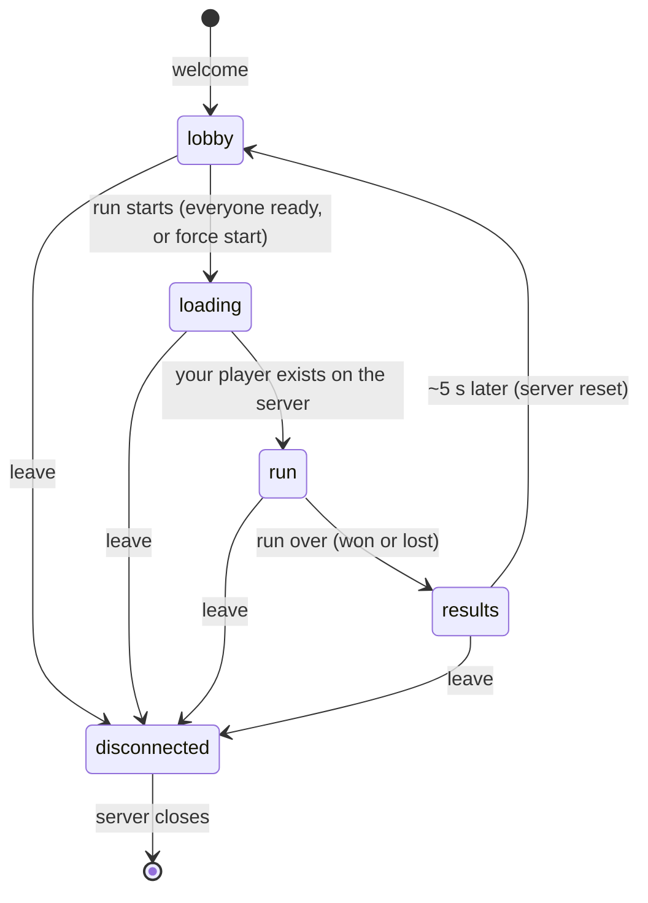

# Open Protocol v1: Thin tier (normative)

The Thin tier is for weak devices (microcontrollers, handhelds, car head units,
terminals). **The server simulates your player.** The client sends controls
(`in`) and draws the authoritative state the server sends back (`snap` +
`ev`). The client never runs physics, hit detection, inventory, or AI.

Read [spec-common.md](spec-common.md) first (framing, hello, errors, limits).

## 1. Message overview

| Direction | JSON `t` | Binary | When |
| --- | --- | --- | --- |
| C → S | `hello` | — | first frame ([spec-common §4](spec-common.md#4-handshake-hello-welcome-error)) |
| S → C | `welcome` / `error` | — | handshake reply |
| S → C | `status` | — | every state change (§3) |
| S → C | `lobby` | — | in state `lobby`, on every change (§4) |
| C → S | `lobby` (actions) | — | states `lobby`, `results` (§4.1) |
| S → C | `load` | — | after `status loading` (§3) |
| C → S | `loaded` | — | optional, when ready to receive snapshots after `load` (§3) |
| C → S | `in` | tag `0x01` (enc `bin`) | state `run`, 30 Hz (§5) |
| S → C | `snap` | tag `0x02` (enc `bin`) | state `run`, up to `rate` Hz (§6, §7) |
| S → C | `ev` | — | after a snapshot when events are pending (§9) |
| C → S | `map_req` | — | any time after `welcome` (§8) |
| S → C | `map` | — | reply to `map_req` |
| S → C | `draft`, `draft_done`, `tape` | — | state `run` (§10) |
| C → S | `choice` | — | state `run` (§10) |
| S → C | `results` | — | after `status results` (§11) |
| both | `ping` / `pong` | — | any time ([spec-common §6](spec-common.md#6-ping-and-pong)) |
| C → S | `leave` | — | any time ([spec-common §7](spec-common.md#7-leaving-disconnects-and-timeouts)) |

With `enc:"bin"` only `in` (C → S, optional) and `snap` (S → C, always) are
binary. Everything else stays JSON text on both transports.

## 2. Negotiation

Thin reads these extra `hello` fields (all optional) and echoes the accepted
values in `welcome`:

| Field | Type | Default | Rule |
| --- | --- | --- | --- |
| `name` | string | `"THIN PLAYER"` | Cleaned: outer whitespace trimmed, characters below U+0020 and U+007F removed, `[`→`(`, `]`→`)`, then cut to 18 characters. Blank or non-string → default. |
| `rate` | integer | 20 | Target snapshot rate in Hz, 2–20. Anything else (missing, non-integer, out of range) → 20. Choose a rate the client can process in normal play. |
| `radius` | number | 0 | Interest radius in metres (3D distance from your position). A positive finite value is clamped to 1–500; anything else → 0 = no filter. Filters `enemies`, `pickups`, `projectiles` and sorts each nearest-first. |
| `max_enemies` | integer | -1 | Cap on `enemies` rows after the radius filter, 0–256. -1 = unlimited. When set, `enemies` is sorted nearest-first even without a radius. Anything else → -1. |

`welcome` example (the server writes `radius` as a float):

```json
{"t":"welcome","v":1,"game_protocol":19,"you":2,"maps":[{"id":"pinecrest","name":"PINECREST"},{"id":"harbor","name":"HARBOR POINT"},{"id":"maple_hollow","name":"MAPLE HOLLOW"}],"tier":"thin","enc":"json","rate":10,"radius":0.0,"max_enemies":-1}
```

Immediately after `welcome` the server sends `status` `lobby` and one `lobby`.
If a run is already in progress it continues straight into the loading
sequence (§3) — late join is automatic.

## 3. Session state machine

`status` = `{"t":"status","state":S,"msg":string}`. `msg` is usually empty
(`"Left session"` on leave). States:



| State | Server sends | Server accepts |
| --- | --- | --- |
| `lobby` | `lobby` on change | `lobby` actions, `map_req`, `ping`, `leave` |
| `loading` | `load` once | `loaded`, `map_req`, `ping`, `leave` (inputs ignored) |
| `run` | `snap`, `ev`, `draft`, `draft_done`, `tape` | `loaded`, `in`, `choice`, `map_req`, `ping`, `leave` |
| `results` | `results` once | `lobby` actions (ready, vote, chat; `start` is ignored), `ping`, `leave` |
| `disconnected` | — | — (socket closes) |

`"connecting"` is reserved and never sent by the current server.

**Loading sequence:** `status loading`, then `{"t":"load","map":"<id>"}` with a
concrete map id (never `"random"`). Load or reset your level resources, then
wait for `status run`. The server switches you to `run` as soon as your player
node exists and the run's loot registry is ready (≈2–4 s after `load`; it
includes the server's 1.35 s map-reveal delay plus scene setup). On entering `run` the server
grants the **pump shotgun starter kit** (pump shotgun in the first hotbar slot, `you.slots[0]`, shells, two
frag grenades, one shield dome) in normal play. If a draft or tape choice is
open, the server sends its state right away. See the
[late-join starter issue](KNOWN_ISSUES.md#6-thin-starter-on-late-join) for that case.

**Snapshot readiness:** After processing `load`, a client MAY send
`{"t":"loaded"}` as soon as it can read snapshots. This is JSON in either
encoding and is accepted before or after `status run`. Until then, the server
sends a first snapshot as soon as possible in `run`, followed by snapshots at
up to 2 Hz. The first valid `in` in `run` also enables the negotiated rate.
With neither message, the server resumes the negotiated rate after 15 s from
when it sent `load`. The grace period resets on each `load`. Clients that wait
for the first snapshot to initialize their controls can keep doing so.

Input sequence state resets on every `load` and on `results`: you MAY restart
`seq` at 0 after each `load`.

## 4. Lobby

`lobby` (S → C) is the complete lobby state, sent whenever it changes (identical
states are not re-sent) and only while you are in state `lobby`:

| Field | Type | Meaning |
| --- | --- | --- |
| `players` | array | Every player on the server (all tiers), in join order: `{id:int, name:string, ready:bool, vote:string, car:bool}`. `vote` is the map id this player voted for or `""`. `car` is `true` for Thin players (legacy name). |
| `maps` | array | Same as `welcome.maps`. |
| `countdown` | integer | Always `-1` (no lobby countdown). |
| `chat` | array | Up to the last 30 lines, oldest first: `{from:string, text:string}`. |
| `vote_counts` | object | `{map_id: count}` for every map with ≥1 vote (`"random"` can appear). |

### 4.1 Lobby actions (C → S)

All are `{"t":"lobby","a":<action>,...}`:

| `a` | Fields | Effect |
| --- | --- | --- |
| `ready` | `v`: bool | Set your readiness. When **every** player in the roster is ready the run starts. Non-bool `v` is ignored. |
| `vote` | `map`: string | Vote for a map id from `maps` or `"random"`. Unknown ids are ignored. A later vote replaces yours. The most-voted id wins; ties are broken at random; no votes → the server's default map. |
| `start` | — | Force start now, regardless of readiness (ignored during `results`). |
| `chat` | `text`: string | Lobby chat. Cleaned like names (control characters removed, brackets → parentheses), cut to 100 characters; empty after cleaning → ignored; more than one line per 700 ms per player → dropped silently. |

A lone player starts the run by sending `ready:true`. The server resets
lobby readiness internally when starting; the final `lobby` frame may still
show everyone ready. Use `status loading` as the transition.

## 5. Input

### 5.1 JSON `in`

```json
{"t":"in","seq":42,"mv":[0,-1],"yaw":1.2,"pitch":-0.25,"b":3,"slot":0,"wheel":0}
```

| Field | Type | Rule |
| --- | --- | --- |
| `seq` | integer | 0 … 9,007,199,254,740,991 (with `enc:"bin"`, JSON `in` is accepted only for 0 … 4,294,967,294). MUST be strictly greater than the last accepted `seq` since the last `load`; stale or duplicate frames are dropped. |
| `mv` | `[x, y]` finite numbers | Movement stick. `x` = right, `y` = **back** (so `[0,-1]` is full forward). Each component is clamped to [-1, 1] and the vector to length ≤ 1. Malformed → whole frame dropped. |
| `yaw` | finite number, radians | **Absolute** body yaw (not a delta), wrapped to [-π, π). 0 faces -Z. Malformed → frame dropped. |
| `pitch` | finite number, radians | **Absolute** head pitch, positive = up. Clamped to ±88° when applied. Malformed → frame dropped. |
| `b` | integer 0–8191 | Held-button bitmask (table below). Out of range → 0. |
| `slot` | integer 0–5 | 0 = no request; 1–5 selects that hotbar slot (edge, see below). Out of range → 0. |
| `wheel` | integer -1, 0, 1 | -1 previous slot, +1 next slot (edge). Out of range → 0. |

| Bit value | Action | Semantics |
| ---: | --- | --- |
| 1 | Fire | Automatic weapons fire while held; others fire on the press edge. With a pouch selected, the press throws it. While Turned, the press is a melee swing. |
| 2 | Aim (ADS) | Held. Slows you to 70 % walk speed; tighter spread. |
| 4 | Jump | Press edge (buffered 0.12 s, coyote 0.12 s). |
| 8 | Crouch | Held (stays crouched under low ceilings). |
| 16 | Sprint | Held; only while moving forward (`mv.y < -0.1`), not aiming/crouching. Sprinting blocks firing. |
| 32 | Reload | Press edge. |
| 64 | Interact | Held: hold-to-use (decon shower 1 s, revive 3 s, pickups/vending per `interact_progress`). |
| 128 | Use utility | Press edge: raise/lower a tarp if you have one. |
| 256 | Drop selected item | Press edge. |
| 512 | Context ping | Press edge (revive ping while downed). |
| 1024 | Ready for next phase | Press edge: skip the rest of Calm/Clearing (all players must ready; only when > 3 s remain). |
| 2048 | Select frag pouch | Press edge; then Fire throws. |
| 4096 | Select shield-dome pouch | Press edge; then Fire throws. |

**Edges.** The server applies queued frames one per physics tick (60 Hz) in
`seq` order. A *press edge* is a bit that is set in an applied frame and clear in
the previously applied frame; to tap a button send it set in one frame and clear
in a later one. `slot`/`wheel` act only when the value **changes** from the
previous applied frame to a nonzero value: to select slot 2 twice in a row send
`slot:2`, then `slot:0`, then `slot:2`. If `slot` and `wheel` change in the same
frame, `slot` wins.

**Timing.** Send `in` at 30 Hz while in `run`, even when nothing changes. The
queue holds 32 frames (oldest dropped on overflow); held state persists between
frames. If no valid frame arrives for **500 ms**, movement and all held buttons
are released (the last view is kept). `snap.ack` tells you the last `seq` the
server actually applied.

**First movement and shot.** After `status run`, wait for a snapshot, then
start at `seq:0` and increment each frame. Compare `you.pos` across
acknowledged snapshots to confirm motion. On an empty Pinecrest test server,
`mv:[0,-1]` and `yaw:0` move the player forward along −Z. To test the starter
shotgun, wait for `you.slots[0].item == "pump_shotgun"`, stop moving and send a
Fire press (`b:1`, then `b:0` on a later input). The shotgun can fire during
Calm without an enemy target. Expect an own-player `shot` event and a lower
`you.slots[0].ammo` on the same or a later snapshot.

### 5.2 Binary input (17 bytes)

Requires `enc:"bin"`. Tag `0x01`. Packed, little-endian:

| Offset | Type | Field |
| ---: | --- | --- |
| 0 | u8 | tag = `0x01` |
| 1 | u32 | `seq`, 0 … 4,294,967,294 (`0xFFFFFFFF` is invalid) |
| 5 | i16 | `mv.x × 32767` (round) |
| 7 | i16 | `mv.y × 32767` |
| 9 | i16 | `yaw × 1000` (milliradians) |
| 11 | i16 | `pitch × 1000` |
| 13 | u16 | button mask `b` |
| 15 | u8 | `slot` 0–5 |
| 16 | i8 | `wheel` -1–1 |

Example — seq 42, full forward, yaw 1.2, pitch -0.25, fire+aim, slot 1, wheel -1:

```text
01 2a 00 00 00 00 00 01 80 b0 04 06 ff 03 00 01 ff
```

(`01 80` = -32767 = forward; `b0 04` = 1200; `06 ff` = -250; `03 00` = fire|aim.)
On WebSocket send these 17 bytes as one binary message; on raw TCP prepend
`11 00 00 00`. A binary frame that is not exactly 17 bytes with tag 1 and a
valid `seq` is a protocol error: the server replies `error` and closes.

## 6. Snapshot (JSON)

Sent in state `run` up to `rate` Hz, subject to loading readiness (§3) and
transport backpressure. While the server transport has pending outbound data,
it skips snapshot sends. When writes drain it samples the latest state.
Snapshots already handed to the network can still arrive late. Treat snapshots
as replaceable state and use the newest one available each frame.
Every list is **complete** for this snapshot (after the radius/cap filter):
remove anything that is no longer listed. Ids are unique per category within a
run and may be reused in a later run.

```json
{"t":"snap","tick":32,"t_ms":11998,"ack":92,
 "you":{...},"players":[...],"enemies":[...],"pickups":[...],"projectiles":[...],
 "weather":{...},"run":{...}}
```

| Field | Type | Meaning |
| --- | --- | --- |
| `tick` | integer | Snapshot counter, strictly increasing for this connection (not reset between runs). |
| `t_ms` | integer | Server monotonic milliseconds when generated. Use differences only. |
| `ack` | integer | Last input `seq` applied to your player, `-1` before any. |

Vectors are `[x,y,z]` metres rounded to 0.01. Angles are radians rounded to
0.001. Fractions are [0,1] rounded to 0.001.

### 6.1 `you`

| Field | Type | Meaning |
| --- | --- | --- |
| `id` | integer | Your id (= `welcome.you`). |
| `pos` | vec3 | Feet position. |
| `vel` | vec3 | Velocity, m/s. |
| `yaw`, `pitch` | number | Applied view (pitch already clamped). |
| `state` | string | `ok` \| `downed` \| `turned` \| `out`. At 0 health you go `downed` (crawl, 20 s bleed-out, twice as fast in rain; a teammate revives with a 3 s Interact hold; solo players get one self-revive per wave). Bleeding out makes you `turned` in co-op (you are a hostile infected that other players can shoot; Fire is a melee swing) or `out` in solo (the run is lost when nobody is `ok`). Turned and out players return as `ok` at the next Clearing, teleported to a spawn. |
| `hp`, `hp_max` | number | Health (0.01 resolution). `hp_max` is 100, or 125 with the Chitin Suit mutation. |
| `suit`, `suit_max` | number | Suit integrity; `suit_max` is 100. Acid rain drains suit first, then health. |
| `exposed` | bool | `!sheltered || in_puddle`: acid can reach you while it rains. |
| `sheltered` | bool | Under a roof/shelter. |
| `in_puddle` | bool | Standing in an acid puddle (overrides shelter). |
| `crouch`, `aiming`, `reloading` | bool | |
| `slot` | integer 1–5 | Selected hotbar slot. |
| `slots` | array[5] | `null` (empty) or `{item, name, ammo, mag, reserve, count}`: `item` catalog id, `name` display name, `ammo` rounds loaded, `mag` magazine size, `reserve` shared reserve of that caliber, `count` stack count (1 for guns). For non-guns `ammo`/`mag`/`reserve` are `null`. |
| `scrap` | integer | Currency for vending cabinets. |
| `revive` | fraction | Progress while you hold Interact on a downed teammate (else 0). |
| `interact_progress` | fraction | Progress of any held interaction. |
| `prompt` | string | Interaction prompt or `""`. Starts with the server's key hint in brackets, e.g. `"[E] Repair"`; strip a leading `[...] ` if you show your own button glyph. |
| `pouch` | string | Selected belt pouch: `"frag"`, `"shield_dome"` or `""`. |
| `grenades`, `domes` | integer | Pouch counts (caps 10 and 5). |

### 6.2 `players[]` (everyone except you)

`{id, name, pos, yaw, pitch, state, item, crouch, suit_color, skin}`:
`item` is the held catalog id (a pouch id while a pouch is selected) or `""`;
`crouch` is a bool for Thin players and `null` for native/Full players (their
transform does not carry crouch); `suit_color` is CSS `"#rrggbb"`; `skin` is the
display name (`"STANDARD"`, `"GAS MASK"`, `"FIREFIGHTER"`, `"BIO-TECH"`,
`"ION RIG"`). Players are not radius-filtered.

### 6.3 `enemies[]`

`{id, type, pos, yaw, hp, anim}`:

| Field | Meaning |
| --- | --- |
| `id` | Positive for infected (the server's `net_id`), `0` for the Cumulus boss, `-peer_id` for a Turned player. |
| `type` | `drip`, `gutter`, `mister`, `hailstone`, `sleet`, `smog`, `static`, `thunderhead`, `undertow`, `cloudburst` (wave-3 miniboss), `cumulus` (wave-5 boss), `turned`. |
| `hp` | Health fraction [0,1]. Boss = sum of its parts. |
| `anim` | Hint: `idle`, `walk`, `windup` (attack tell), `attack` (recovering after an attack), `stagger`, `die` (Cumulus only, briefly after death). `spawn` is reserved. |

Infected vanish from the list when they die (a `kill` event fires). The
Cumulus stays listed with `anim:"die"` for a moment.

### 6.4 `pickups[]`

`{id, item, pos, kind}`. `kind` ∈ `weapon` (a gun), `ammo`, `health`, `suit`,
`scrap`, `item` (any other catalog item, e.g. `frag`, `med_tin`), `airdrop`,
`station` (vending cabinet). `item` is the catalog id, or the supply flavour
(`ammo`, `supply`, `ammo_box`, `health`, `suit`, `scrap`, `scrap_large`, `tarp`,
`decon`), or `"airdrop"`/`"station"`. Cabinets and airdrops have **negative
64-bit** ids (e.g. `-303080413257`). Supplies and scrap are collected
automatically by walking within reach; weapons/items need Interact.

### 6.5 `projectiles[]`

`{id, kind, pos, vel}`. Player projectiles and deployables have positive ids and
`kind` = the item/weapon id (`frag`, `shield_dome`, `nail_driver`, `harpoon`,
`flare_launcher`, `boombox_launcher`, `sandbag`, `umbrella`, `lightning_rod`,
`bait_radio`, `bleach_bomb`, `disruptor`, …); deployed objects report
`vel = [0,0,0]`. Enemy hazards have negative ids and `kind` `spore` or
`acid_glob`.

### 6.6 `weather` and `run`

`weather` = `{phase, intensity, wave, phase_time_left, lightning}`:
`phase` ∈ `calm`, `drizzle`, `downpour`, `acid_storm` (reported while the storm
is at full intensity, i.e. wave-5 downpour), `clearing`; `intensity` storm
strength [0,1]; `wave` ≥ 1; `phase_time_left` seconds (the Calm timer pauses
during a mutation draft; Downpour can last past 0 until the wave is cleared);
`lightning` true if any strike happened since your previous snapshot.

`run` = `{alive_enemies, wave, endless, shared_decon, score}`:
`alive_enemies` counts live infected, Turned players and a live boss **before**
radius/cap filtering; `wave` = `weather.wave`; `endless` true after the squad
chose to continue past wave 5; `shared_decon` squad decon-shower charges;
`score` endless-mode score.

## 7. Binary snapshot layout

With `enc:"bin"` every snapshot is one binary message with tag `0x02`. Packed,
no padding, little-endian. Types: `uN`/`iN` unsigned/signed N-bit; `bool` = u8
0/1; `str` = u16 byte length + UTF-8 bytes (no terminator); `pos` = 3 × i32
centimetres; `vel` = 3 × i16 cm/s saturated to ±32767; `ang` = i16
milliradians; `c100` = u16 hundredths; `f1000` = u16 thousandths; nullable u16
uses `65535` = null; enum = u8 index, `255` = unknown.

| # | Field | Encoding |
| ---: | --- | --- |
| 1 | tag | u8 = 2 |
| 2 | tick | u32 |
| 3 | t_ms | u64 |
| 4 | ack | u32, `0xFFFFFFFF` = -1 |
| 5 | you.id | u32 |
| 6 | you.pos | pos |
| 7 | you.vel | vel |
| 8 | you.yaw, you.pitch | ang, ang |
| 9 | you.state | enum State |
| 10 | you.hp, hp_max, suit, suit_max | 4 × c100 |
| 11 | you.flags | u8: bit0 exposed, bit1 sheltered, bit2 in_puddle, bit3 crouch, bit4 aiming, bit5 reloading, bits 6–7 zero |
| 12 | you.slot | u8 (1–5) |
| 13 | you.slots × 5 | each: u8 present; if present ≠ 0: str item, str name, u16 ammo, u16 mag, u16 reserve, u16 count (nullable, 65535 = null) |
| 14 | you.scrap | u32 |
| 15 | you.revive, you.interact_progress | f1000, f1000 |
| 16 | you.prompt, you.pouch | str, str |
| 17 | you.grenades, you.domes | u16, u16 |
| 18 | players | u16 count, then each: u32 id, pos, ang yaw, ang pitch, enum State, u8 crouch (0, 1, 2 = null), str name, str item, u32 suit_color, str skin |
| 19 | enemies | u16 count, then each: i32 id, enum EnemyType, pos, ang yaw, f1000 hp, enum Anim |
| 20 | pickups | u16 count, then each: i64 id, enum PickupKind, pos, str item |
| 21 | projectiles | u16 count, then each: i64 id, pos, vel, str kind |
| 22 | weather | enum Phase, f1000 intensity, u32 wave, u32 phase_time_left (hundredths of a second), bool lightning |
| 23 | run | u16 alive_enemies, bool endless, u16 shared_decon, u32 score (run.wave = weather.wave) |

`suit_color` is `0xRRGGBBAA` written as a little-endian u32, so the bytes on the
wire are `AA BB GG RR` (alpha is `FF`); `#2ec9c9` → `ff c9 c9 2e`.

Enum orders (index 0 first):

| Enum | Values |
| --- | --- |
| State | `ok`, `downed`, `turned`, `out` |
| EnemyType | `drip`, `gutter`, `mister`, `hailstone`, `sleet`, `smog`, `static`, `thunderhead`, `undertow`, `cloudburst`, `cumulus`, `turned` |
| Anim | `spawn`, `idle`, `walk`, `attack`, `windup`, `stagger`, `die` |
| PickupKind | `weapon`, `ammo`, `health`, `suit`, `scrap`, `item`, `airdrop`, `station` |
| Phase | `calm`, `drizzle`, `downpour`, `acid_storm`, `clearing` |

A decoder MUST consume exactly the message length; trailing bytes indicate a
layout mismatch.

### 7.1 Worked example (104 bytes)

tick 1, t_ms 1000, ack 42; you: id 2 at (1.25, 0, -2), at rest, `ok`, 100 hp /
100, suit 100 / 100, exposed, slot 1, five empty slots, no scrap, no prompt;
no other entities; wave 1 calm, 12 s left; four decon charges.

```text
0000 02 01 00 00 00 e8 03 00 00 00 00 00 00 2a 00 00
0010 00 02 00 00 00 7d 00 00 00 00 00 00 00 38 ff ff
0020 ff 00 00 00 00 00 00 00 00 00 00 00 10 27 10 27
0030 10 27 10 27 01 01 00 00 00 00 00 00 00 00 00 00
0040 00 00 00 00 00 00 00 00 00 00 00 00 00 00 00 00
0050 00 00 00 00 00 00 01 00 00 00 b0 04 00 00 00 00
0060 00 00 04 00 00 00 00 00
```

| Bytes | Meaning |
| --- | --- |
| `02` | tag |
| `01 00 00 00` | tick 1 |
| `e8 03 00 00 00 00 00 00` | t_ms 1000 |
| `2a 00 00 00` | ack 42 |
| `02 00 00 00` | you.id 2 |
| `7d 00 00 00` `00 00 00 00` `38 ff ff ff` | pos (125, 0, -200) cm |
| `00 00 ×3` | vel 0 |
| `00 00` `00 00` | yaw 0, pitch 0 |
| `00` | state ok |
| `10 27` ×4 | hp, hp_max, suit, suit_max = 10000 hundredths |
| `01` | flags: exposed |
| `01` | slot 1 |
| `00` ×5 | five empty slots |
| `00 00 00 00` | scrap 0 |
| `00 00` `00 00` | revive 0, interact_progress 0 |
| `00 00` `00 00` | prompt "", pouch "" |
| `00 00` `00 00` | grenades 0, domes 0 |
| `00 00` ×4 | 0 players, enemies, pickups, projectiles |
| `00` `00 00` `01 00 00 00` `b0 04 00 00` `00` | weather: calm, 0.000, wave 1, 1200 hundredths = 12 s, no lightning |
| `00 00` `00` `04 00` `00 00 00 00` | run: 0 alive, not endless, 4 decon, score 0 |

The [thin-bin transcript](transcripts/thin-bin.md) contains real snapshots with
players, enemies, pickups and projectiles.

## 8. Map outline

`{"t":"map_req"}` → `map`:

```json
{"t":"map","id":"pinecrest","boxes":[[0.0,0.03,0.0,134.0,0.06,9.0,0.0], ...],"bounds":{"min":[-68.2,-1.0,-67.0],"max":[68.2,23.0,67.0]}}
```

Each box is `[cx, cy, cz, sx, sy, sz, yaw]`: centre, full size (metres), and
yaw (radians) of an upright oriented box approximating static world collision
(physics layer 1: CSG and static bodies). `bounds` is the world AABB of all
boxes. Before a level is loaded (e.g. in the lobby) the reply is
`{"t":"map","id":null,"boxes":[],"bounds":null}`. Outlines are cached per map
and can be tens of KiB; request once per `load`. They are a rendering aid only —
snapshots are authoritative, and accurate geometry comes from the exported
asset pack ([game-reference.md §7](game-reference.md#7-exported-asset-pack)).

## 9. Events

`{"t":"ev","list":[...]}` follows a snapshot whenever events are pending
(and is flushed once more before `results`). While snapshot sends are delayed,
the server batches pending events for the next send and combines damage in a
single `hurt` event. Each element has a string `e`. Events are transient and
can be lost when more than 256 accumulate. Snapshot lists stay authoritative.
Draft transitions and results retain their order in the reliable stream.
Ignore unknown `e` values.

| `e` | Fields | Notes |
| --- | --- | --- |
| `shot` | `by` shooter id, `weapon` catalog id, `from` muzzle vec3, `to` end vec3 | Any player's hitscan shot, one per pellet/trace. Draw a tracer. Projectile weapons also emit one; their flight is in `projectiles`. |
| `hit` | `at` vec3, `head` bool, `dmg` integer | Only to the shooter: your shot hit something damageable. |
| `kill` | `enemy` id, `type` EnemyType string | An enemy died (boss: `enemy:0`, `type:"cumulus"`). |
| `hurt` | `amt` number, `dir` vec3 \| null | Only to the victim: damage accumulated since the last batch (0.01 resolution); `dir` is a unit vector from you toward the source when known (within 250 ms), else `null`. |
| `lightning` | `at` vec3 | A strike (ambient or tactical). Flash the sky; thunder follows as a `sound`. |
| `sound` | `name` cue string, `at` vec3 \| null | A sound the server played; `at:null` is non-spatial (UI/music cue). Cue names match the asset pack's `audio/sound_map.json`. |
| `banner` | `text` string | Centre-screen banner (e.g. `"WAVE 1 CLEAR"`). |
| `puddle` | `id` integer, `pos` vec3, `radius` number, `on` bool | Acid puddle (or acid spore-cloud lobe) created/resized (`on:true`) or removed (`on:false`). Sampled every 200 ms; resent when the radius changes by ≥ 0.10 m; puddles smaller than 0.25 m are not reported. Ids are 64-bit. |
| `pickup` | `item` id or supply flavour | Only to the collector. |

## 10. Draft and tape choices

- **Mutation draft** (wave 2+, start of Calm):
  `{"t":"draft","kind":"mutation","cards":[{"id","title","desc","icon"}, ...],"time_left":14.0}`
  — up to three cards; `icon` equals `id` (see
  [game-data.json](game-data.json) `player_mutations`). Vote with
  `{"t":"choice","kind":"mutation","i":0|1|2}` (zero-based; a later vote replaces
  the earlier one). The draft resolves when everyone has voted (after ~0.6 s) or
  after `time_left`; then `{"t":"draft_done"}`. The winning mutation applies to the
  whole squad (it shows up in your stats; there is no separate result message).
  Joining while a draft is open sends `draft` on entering `run`.
- **Endless tape** (after the wave-5 boss): `{"t":"tape","time_left":null,"can_choose":bool}`.
  Only the player with `can_choose:true` (the first player in the roster) may
  answer `{"t":"choice","kind":"tape","i":0}` (continue into endless waves) or
  `"i":1` (end the run as a victory). There is no timeout. The outcome shows as
  `run.endless:true` in later snapshots, or as `results`. `tape` is re-sent if the
  decider changes.

Out-of-range `i`, wrong `kind`, or choices outside state `run` are ignored.

## 11. Results and return to the lobby

When the run ends (all players down/out, or victory) the server flushes pending
events, then sends `status results` and:

```json
{"t":"results","won":false,"time_s":106,"waves":1,"kills":15,"players":[{"name":"Thin Bot","kills":7,"downs":0,"revives":0},{"name":"Full Bot","kills":8,"downs":0,"revives":0}],"score":0}
```

`time_s` run length in whole seconds; `waves` waves survived; `kills` squad
total; `players` one row per player of any tier; `score` endless score. No
snapshots are sent in `results`. About **5 s** later the server resets and sends
`status lobby` + `lobby`. You may send lobby actions (ready, vote, chat) during
`results`; if everyone is ready when the server resets, the next run starts
immediately.

## 12. Errors and edge cases

- After `welcome`, a frame that is not a JSON object with string `t`, a binary
  frame with `enc:"json"`, or a malformed binary input is answered with
  `error` `Expected an Open Protocol message` **and the connection is closed**.
- Unknown `t` values and out-of-state messages are ignored silently.
- Your player can be removed only by `leave` or by closing the socket.
- A Thin player that disconnects mid-run spills its inventory as pickups; its
  slot in the 4-player cap is freed immediately.
- See [KNOWN_ISSUES.md](KNOWN_ISSUES.md) for current deviations.
